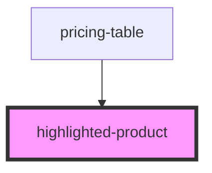

# highlighted-product

<!-- Auto Generated Below -->

## Properties

| Property             | Attribute              | Description                                                                                     | Type      | Default     |
| -------------------- | ---------------------- | ----------------------------------------------------------------------------------------------- | --------- | ----------- |
| `callToActionLabel`  | `call-to-action-label` |                                                                                                 | `string`  | `undefined` |
| `product`            | --                     |                                                                                                 | `Product` | `undefined` |
| `recommended`        | `recommended`          | Lights the card up, e.g. when the selected number of seats is better served by talking to sales | `boolean` | `false`     |
| `recommendedBadge`   | `recommended-badge`    |                                                                                                 | `string`  | `undefined` |
| `recommendedMessage` | `recommended-message`  |                                                                                                 | `string`  | `undefined` |

## Events

| Event            | Description | Type                   |
| ---------------- | ----------- | ---------------------- |
| `productClicked` |             | `CustomEvent<Product>` |

## Dependencies

### Used by

 - [pricing-table](..)

### Graph

----------------------------------------------

*Built with [StencilJS](https://stenciljs.com/)*
